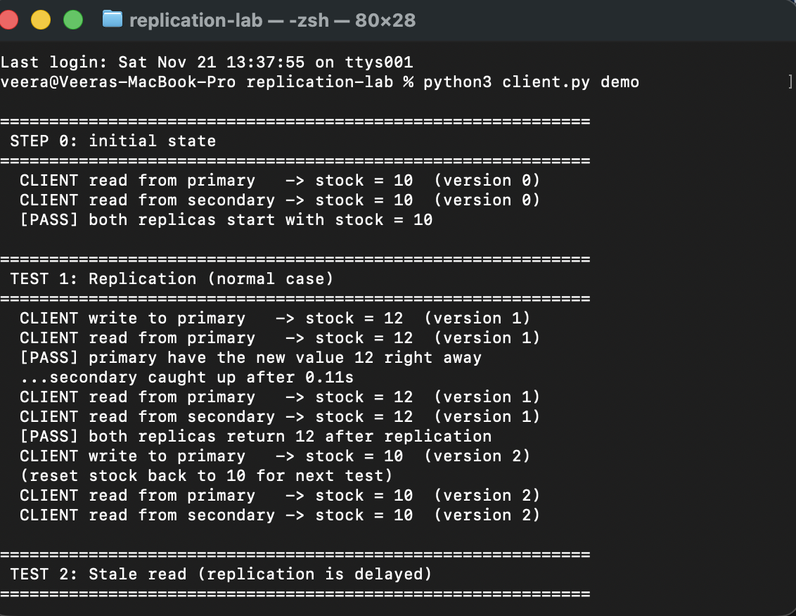
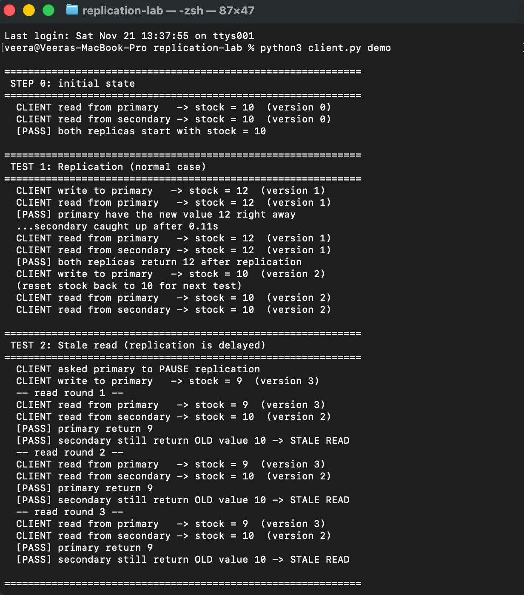
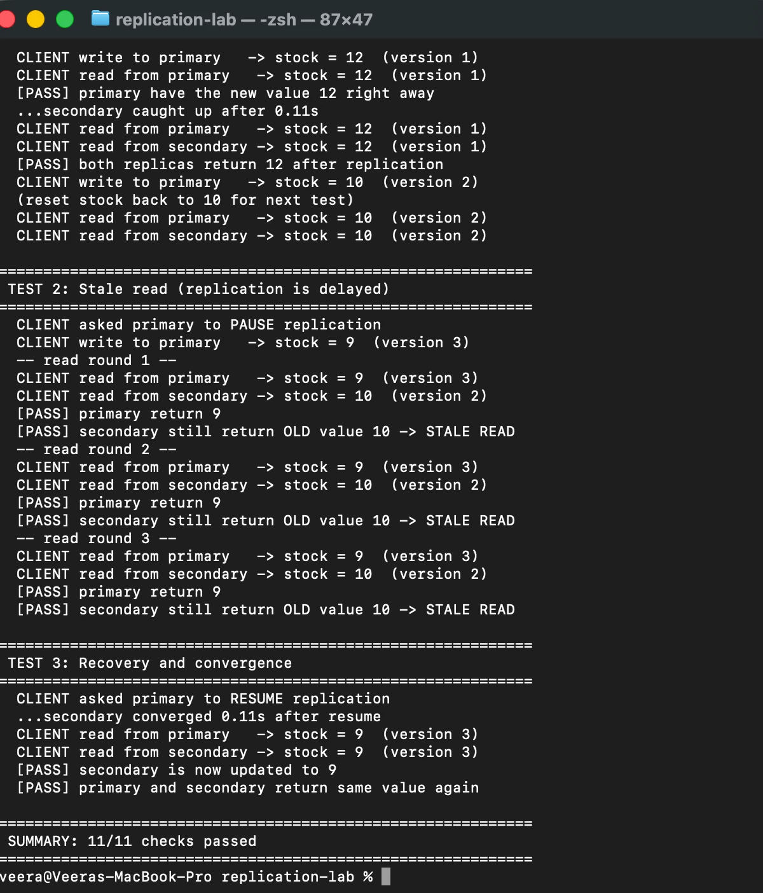
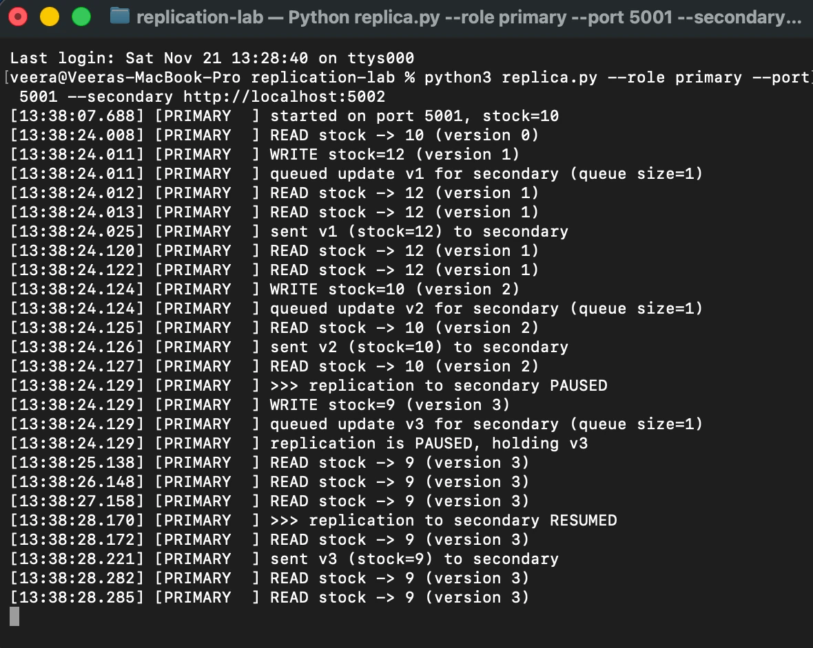
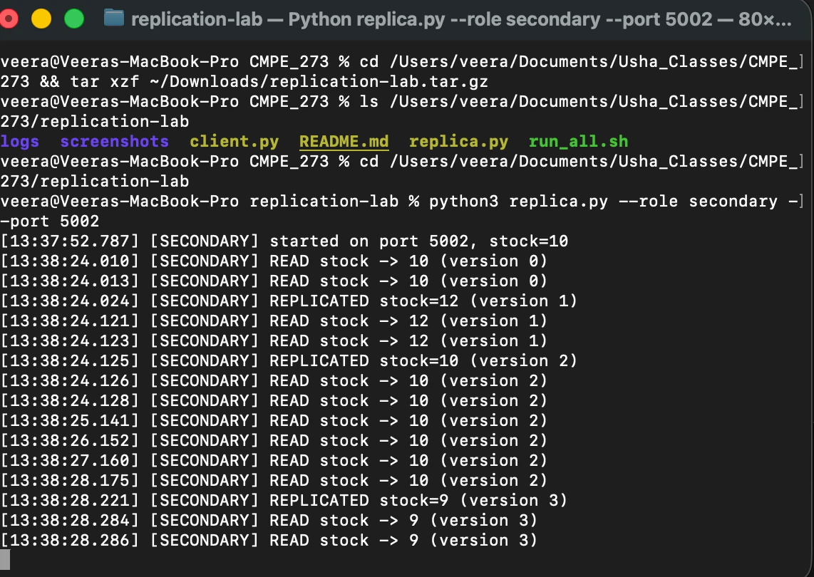

# Module 8 – Replication & Consistency (Inventory Lab)

CMPE 273 – Module 8 assignment

In this lab I made a small inventory system with one **Primary** replica and one **Secondary** replica. The client writes `stock` to the Primary, and Primary send the update to Secondary in the background (asynchronous replication). After that I pause replication on purpose to see the stale read, and then I resume it to check that both replicas come back to same value.

I wrote it in **Python 3** and only use the standard library (`http.server`, `urllib`, `threading`, `queue`), so no need to install anything with pip.

---

## Files in this repo

| File | What it does |
|------|------|
| `replica.py` | One replica as a small HTTP server. Same file runs as `primary` or `secondary` (with `--role`). |
| `client.py` | Client for read/write from any replica, pause/resume replication, and the `demo` that runs all 3 tests. |
| `run_all.sh` | Start both replicas, run the demo, print all the logs, and stop everything at the end. |
| `logs/` | Logs from my run (client output, primary log, secondary log). |
| `screenshots/` | Screenshots of the program running. |

---

## How to run

You need Python 3.8 or newer. I tested on Python 3.13.

### Option A – one command (easy way)

```bash
chmod +x run_all.sh
./run_all.sh
```

This start the secondary on port `5002` and the primary on port `5001`, then runs `python3 client.py demo`, and at the end it prints the primary and secondary logs.

### Option B – 3 terminals (good to see what is happening live)

Terminal 1 – Secondary:
```bash
python3 replica.py --role secondary --port 5002
```

Terminal 2 – Primary:
```bash
python3 replica.py --role primary --port 5001 --secondary http://localhost:5002
```

Terminal 3 – Client:
```bash
python3 client.py demo
```

You can also run the steps one by one by hand from terminal 3:

```bash
python3 client.py read primary
python3 client.py read secondary
python3 client.py pause
python3 client.py write 9
python3 client.py read secondary     # still 10 -> stale
python3 client.py resume
python3 client.py read secondary     # now 9
```

Stop the replicas with `Ctrl+C`.

---

## Architecture

```
                      writes (POST /stock)
   +----------+  ---------------------------------->  +-------------------+
   |          |                                       |  PRIMARY  :5001   |
   |          |  <---------- reads (GET /stock) ----  |  stock = 10       |
   |  CLIENT  |                                       |  version = N      |
   | client.py|                                       |  [ repl queue ]---+--+
   |          |                                       +-------------------+  |
   |          |                                         pause / resume       |  async
   |          |                                         (control endpoint)   |  POST /replicate
   |          |                                                              |  {key, value, version}
   |          |                                       +-------------------+  |
   |          |  <---------- reads (GET /stock) ----  |  SECONDARY :5002  |<-+
   +----------+                                       |  stock = 10       |
                                                      |  version = N      |
                                                      +-------------------+
```

How it works:

1. Client send a write only to the **Primary**. Secondary reject writes from the client (HTTP 403).
2. Primary change its own value right away, increase the version number, and put the update in a **replication queue**. It answers the client without waiting for Secondary. So this is asynchronous replication.
3. A background thread in the Primary takes updates from the queue and sends them to `POST /replicate` on Secondary.
4. Secondary apply the update only if the version is newer than what it have. Because of this, an old or duplicate update cannot overwrite a new value.
5. Client can read from **either** replica with `GET /stock`.
6. To make the delay, Primary have `POST /replication/pause` and `POST /replication/resume`. When it is paused the worker thread just keeps the update in the queue and don't send it. (There is also `POST /replication/delay` with `{"seconds": 2}` if you want a slow link instead of full stop.)

---

## Results

Below is the real output from my run on my MacBook (3 terminals: secondary, primary, client). Same logs are saved in the `logs/` folder.

### 1. Replication

Client write `stock = 12` to Primary. Primary have it right away, and Secondary got the same value in around 0.11 sec.

```
============================================================
 TEST 1: Replication (normal case)
============================================================
  CLIENT write to primary   -> stock = 12  (version 1)
  CLIENT read from primary   -> stock = 12  (version 1)
  [PASS] primary have the new value 12 right away
  ...secondary caught up after 0.11s
  CLIENT read from primary   -> stock = 12  (version 1)
  CLIENT read from secondary -> stock = 12  (version 1)
  [PASS] both replicas return 12 after replication
```

Server side logs for the same moment:

```
[13:38:24.011] [PRIMARY  ] WRITE stock=12 (version 1)
[13:38:24.011] [PRIMARY  ] queued update v1 for secondary (queue size=1)
[13:38:24.024] [SECONDARY] REPLICATED stock=12 (version 1)
[13:38:24.025] [PRIMARY  ] sent v1 (stock=12) to secondary
```

After this test I set the stock back to 10, so the stale read test starts from `stock = 10` like in the assignment.



### 2. Stale read test

I paused replication, then updated Primary from `10` to `9`. I read from both replicas 3 times, one second apart. Primary always give `9`, but Secondary still give the old `10`. This is the **stale read**: the client asks Secondary and gets a value which is not true anymore.

```
============================================================
 TEST 2: Stale read (replication is delayed)
============================================================
  CLIENT asked primary to PAUSE replication
  CLIENT write to primary   -> stock = 9  (version 3)
  -- read round 1 --
  CLIENT read from primary   -> stock = 9  (version 3)
  CLIENT read from secondary -> stock = 10  (version 2)
  [PASS] primary return 9
  [PASS] secondary still return OLD value 10 -> STALE READ
  -- read round 2 --
  CLIENT read from primary   -> stock = 9  (version 3)
  CLIENT read from secondary -> stock = 10  (version 2)
  [PASS] primary return 9
  [PASS] secondary still return OLD value 10 -> STALE READ
  -- read round 3 --
  CLIENT read from primary   -> stock = 9  (version 3)
  CLIENT read from secondary -> stock = 10  (version 2)
  [PASS] primary return 9
  [PASS] secondary still return OLD value 10 -> STALE READ
```

Primary log shows the update is waiting in the queue:

```
[13:38:24.129] [PRIMARY  ] >>> replication to secondary PAUSED
[13:38:24.129] [PRIMARY  ] WRITE stock=9 (version 3)
[13:38:24.129] [PRIMARY  ] queued update v3 for secondary (queue size=1)
[13:38:24.129] [PRIMARY  ] replication is PAUSED, holding v3
[13:38:25.138] [PRIMARY  ] READ stock -> 9 (version 3)
[13:38:26.148] [PRIMARY  ] READ stock -> 9 (version 3)
[13:38:27.158] [PRIMARY  ] READ stock -> 9 (version 3)
```

and in the same time Secondary keeps answering with the old value:

```
[13:38:25.141] [SECONDARY] READ stock -> 10 (version 2)
[13:38:26.152] [SECONDARY] READ stock -> 10 (version 2)
[13:38:27.160] [SECONDARY] READ stock -> 10 (version 2)
```

The version numbers make it easy to see: Primary is on version 3 and Secondary is still on version 2, so it is one update behind.



### 3. Recovery and convergence

When I resume replication, the queued update (v3) goes to Secondary and it becomes `9`. Both replicas give the same value and same version again.

```
============================================================
 TEST 3: Recovery and convergence
============================================================
  CLIENT asked primary to RESUME replication
  ...secondary converged 0.11s after resume
  CLIENT read from primary   -> stock = 9  (version 3)
  CLIENT read from secondary -> stock = 9  (version 3)
  [PASS] secondary is now updated to 9
  [PASS] primary and secondary return same value again

============================================================
 SUMMARY: 11/11 checks passed
============================================================
```

Logs:

```
[13:38:28.170] [PRIMARY  ] >>> replication to secondary RESUMED
[13:38:28.221] [PRIMARY  ] sent v3 (stock=9) to secondary
[13:38:28.221] [SECONDARY] REPLICATED stock=9 (version 3)
[13:38:28.284] [SECONDARY] READ stock -> 9 (version 3)
```

One thing I noticed: even after resume, a read which comes very quick can still be stale. In the secondary log there is a read at `13:38:28.175` (just after resume at `28.170`) that still returns `10`, and the replicated value only arrives at `28.221`. So "eventually" really means eventually, it's not at the exact moment you resume.



### Server side terminals

Primary terminal – you can see the write of 9 is held while paused and only sent after resume:



Secondary terminal – it keeps returning 10 (version 2) during the pause, and gets `REPLICATED stock=9 (version 3)` after resume:



### Full logs

- [`logs/client_demo.log`](logs/client_demo.log)
- [`logs/primary.log`](logs/primary.log)
- [`logs/secondary.log`](logs/secondary.log)

---

## Reflection

Reading from a replica is fast and it takes load away from the primary, but the replica can be behind, so the reader may get an old value like the `10` I got from Secondary after stock was already `9`. If we want the reader to always see the latest value, we have to read from the primary or make the write wait until all replicas confirm it (synchronous replication). That makes reads or writes slower, and the system is less available when a replica is slow or down. So it is a tradeoff between speed/availability and freshness of the data. For inventory, a small stale read is okay for showing "in stock" on a product page, but for the final checkout we should read from the primary so we don't sell an item that is already gone.
